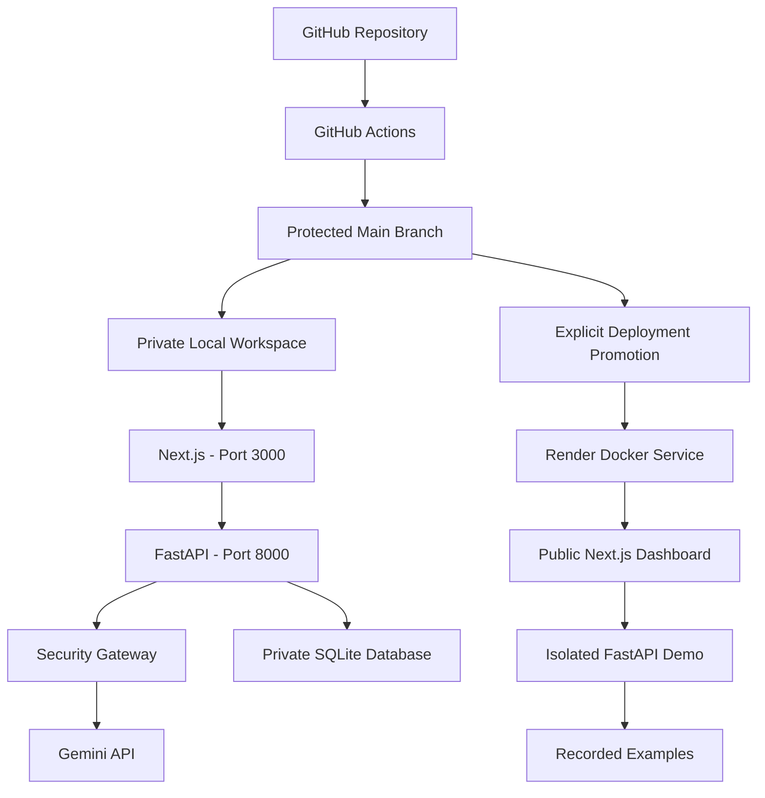
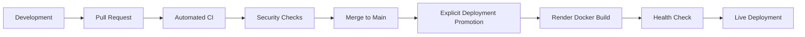

# Aegis AI — Personal Agent

A privacy-first, local-first personal AI assistant designed to bring
intelligence, productivity, research and task automation into a
unified workspace.


## Live Demo

**Explore Aegis AI:** https://aegis-ai-369j.onrender.com

The public demo showcases the dashboard, assistant interface,
structured responses, Markdown tables and code examples.

The hosted version uses isolated, recorded examples rather than
live Gemini inference. No personal information, private credentials
or owner database is exposed.

> Free hosting may introduce a cold-start delay after inactivity.

## Project Vision

Aegis AI is being developed as a modular personal intelligence
platform that combines conversational AI with secure task execution,
research, productivity tools and personal workflow management.

The project prioritizes:

- Privacy and user-controlled permissions.
- Local-first storage and execution.
- Modular, extensible architecture.
- Secure cloud AI integration.
- Automated testing and continuous deployment.
- Incremental delivery of production-quality features.

## Current Features

### Conversational AI

- Live Gemini integration in the private local workspace.
- Multi-turn conversations with bounded context.
- Structured Markdown responses.
- Code blocks, tables and technical explanations.
- Copy responses and start new conversations.
- Persistent conversation history with explicit retention.
- Reopen, rename and delete saved conversations.
- Restore the active saved conversation after refresh.
- Gemini quota, timeout and temporary failure handling.
- Model provider abstraction.

### Dashboard

- Separate Overview and AI Assistant workspaces.
- Shared Owner and Guest dashboard components.
- Server-controlled runtime access selection.
- Persistent Owner preferences and privacy controls.
- Temporary Guest preference interactions.
- Responsive interface with collapsible navigation.
- Dark and light themes.
- System status and approval UI.
- Dedicated placeholders for future integrations.

### Authentication and Security

- Single-owner authentication.
- Argon2id password hashing.
- Session-based authentication.
- HttpOnly session cookies.
- Session expiration and revocation.
- Login attempt rate limiting.
- Backend gateway authentication.
- Request and origin validation.
- Application-level outbound AI policy enforcement.
- Configurable AI usage limits and emergency stop.

### Local Persistence

- SQLite database.
- Versioned database migrations.
- Owner and session storage.
- Login attempt tracking.
- AI usage tracking when application limits are enabled.
- Private runtime files stored outside the repository.
- Restrictive filesystem permissions.
- SQLite schema v4 conversation storage.
- Transactional retention enforcement.
- Owner-scoped conversation history.
- Database integrity diagnostics.
- Application-level encryption is not implemented.

### Deployment

- Multi-stage Docker build.
- Private Docker Compose frontend and backend services.
- Separate public demo packaged in one container.
- Separate public demo backend.
- Non-root container execution.
- Automated container smoke tests.
- Health monitoring.
- Continuous deployment through Render.

## Architecture



## Technology Stack

| Layer | Technology |
|---|---|
| Frontend | Next.js, React, TypeScript |
| Styling | Tailwind CSS, CSS, Lucide |
| Backend | Python, FastAPI, Uvicorn |
| AI | Google Gemini, model provider abstraction |
| Database | SQLite |
| Authentication | Argon2id, session tokens |
| Testing | Pytest, HTTPX |
| Containerization | Docker |
| CI/CD | GitHub Actions, Render |
| Security | CodeQL, Gitleaks, Bandit, pip-audit, npm audit |

## Repository Structure

```text
Personal-Agent/
├── backend/
│   ├── aegis/
│   │   ├── api/
│   │   ├── models/
│   │   ├── schemas/
│   │   ├── security/
│   │   ├── services/
│   │   ├── storage/
│   │   ├── demo.py
│   │   └── main.py
│   ├── tests/
│   └── pyproject.toml
├── frontend/
│   ├── src/
│   │   ├── app/
│   │   ├── components/
│   │   └── lib/
│   └── package.json
├── deploy/
│   ├── start.sh
│   └── smoke.sh
├── docs/
├── .github/workflows/
├── Dockerfile
├── .dockerignore
├── render.yaml
└── README.md
```

## Local Development

### Prerequisites

- Python 3.12 recommended.
- Node.js 24.
- npm.
- Git.
- Docker Desktop with Docker Compose.

### Backend Setup

From the repository root:

```bash
cd backend
python3.12 -m venv .venv
source .venv/bin/activate
python -m pip install -e '.[dev]'
python -m pytest -q
```

### Private Runtime Configuration

Keep runtime credentials and databases outside the repository.

Recommended macOS location:

`~/Library/Application Support/AegisAI/`

The existing private runtime uses:

- `runtime.env` for backend AI configuration.
- `gateway.env` for internal gateway authentication.
- `aegis.sqlite3` for local persistence.

Initialize the database and owner account using the project's
CLI before attempting authenticated access on a fresh installation.

Never commit runtime credentials or copy the owner database
into the public deployment.

### Start the Private Workspace

For an already configured private Docker runtime:

```bash
docker compose -f compose.private.yaml up -d --build --wait
docker compose -f compose.private.yaml ps
```

Open http://127.0.0.1:3000.

Daily operation:

```bash
docker compose -f compose.private.yaml up -d
docker compose -f compose.private.yaml ps
docker compose -f compose.private.yaml logs --tail=50
docker compose -f compose.private.yaml stop
```

The private database lives in a persistent Docker volume.
The native macOS database is separate.

Never remove the private Docker volume unintentionally.

### AI and Conversation Privacy

Cloud AI requires runtime authorization and Owner permission.

The AEGIS_UNLIMITED_AI flag disables application quotas,
not provider quotas or costs.

Conversation retention is disabled by default.
Enable it through Settings > Privacy.

Disabling retention stops new saves without deleting
previously saved conversations.

Only saved conversations survive browser refresh.
Browser session storage remembers only the selected chat ID.

Local database storage is not application-encrypted.

## Run the Public Demo Locally

```bash
docker build -t aegis-demo:local .

bash deploy/smoke.sh aegis-demo:local

docker run --rm \
    --memory=512m \
    --memory-swap=512m \
    -p 127.0.0.1:8080:10000 \
    aegis-demo:local
```

Open http://127.0.0.1:8080.

No Gemini credentials are required for this demo.

## Application Environments

| Environment | Address |
|---|---|
| Private frontend | http://127.0.0.1:3000 |
| Private backend | Internal Docker service: backend:8000 |
| Local Docker demo | http://127.0.0.1:8080 |
| Hosted public demo | https://aegis-ai-369j.onrender.com |

## Continuous Integration and Deployment



The pipeline includes:

- Backend unit and integration tests.
- ESLint and TypeScript validation.
- Frontend production builds.
- Docker builds and smoke tests.
- CodeQL analysis.
- Secret scanning.
- Python security scanning.
- Frontend and backend dependency audits.
- Workflow validation.

Render watches the deployment branch using the
After CI Checks Pass setting.

Merging into main does not publish changes.
Deployment promotion requires explicit approval.

## Branch Strategy

| Branch | Responsibility |
|---|---|
| main | Stable production source |
| frontend | Dashboard and user interface |
| backend | APIs and application services |
| conversation | Conversational AI |
| database | Storage and migrations |
| security | Authentication and security |
| deployment | Hosting, Docker and CI/CD |

Changes are merged through pull requests after required
checks pass. Development branches are retained and synchronized
with main.

## Engineering Milestones

Initial public deployment — November 22, 2026:

- 359 automated backend tests passed.
- 18 GitHub CI checks passed on the deployment PR.
- Zero npm vulnerabilities reported during validation.
- Local Docker smoke-test memory usage: 88.2 MiB.
- Render free instance memory allocation: 512 MiB.
- First successful production deployment: 1 minute 7 seconds.
- Initial public hosting cost: $0/month within free-tier limits.

These measurements represent the initial release validation,
not sustained production performance guarantees.

## Development Roadmap

| Version | Scope |
|---|---|
| v0.1.0 | Initial MVP and isolated public demo |
| v0.2.0 | Owner AI, shared runtime, settings and persistent conversations |
| v0.3.0 | Basic workspace functionality and optional local AI models |
| v0.4.0 | Job search workflows |
| v0.5.0 | Tasks, memory and approval engine |
| v0.6.0+ | External integrations and controlled automation |

Later roadmap items are planned, not implemented.

## v0.2.0 Release Candidate

- 520 automated backend tests passed.
- 19 CI checks passed on PRs #46 and #47.
- 11 conversation end-to-end checks passed.
- Six additional navigation checks passed.
- SQLite schema v4 migration and backup verified.
- Public and private conversation isolation verified.
- Public Docker smoke-test memory usage: 97.6 MiB.

These are development validation results, not production
performance guarantees.

The hosted demo remains on the previously published release
until explicit deployment promotion.

## Security and Privacy

The private workspace and public demo have separate runtime
boundaries.

The public container does not run the owner API, open the private
database, accept arbitrary AI prompts or call Gemini.

Private cloud chat sends user-submitted text and enabled context
to Gemini. Users must not submit private or sensitive information.
Application-level filtering cannot guarantee detection of all
sensitive information.

The current security controls are not an operating-system sandbox.
External actions and autonomous execution are not enabled.

## Project Status

Aegis AI is under active development.

The v0.2.0 release candidate demonstrates conversational AI, authenticated
local operation, local persistence, security foundations and a
reproducible deployment pipeline.

## Author

**Venkata Sri Sai Surya Mandava**

Software Engineering | Distributed Systems | Applied AI

GitHub: https://github.com/VenkataSriSaiSuryaMandava

Live demo: https://aegis-ai-369j.onrender.com
