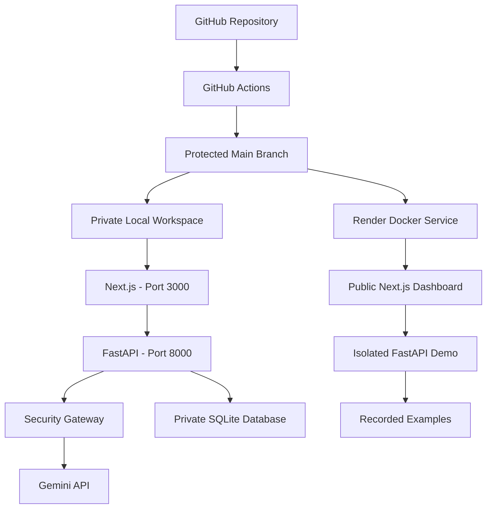
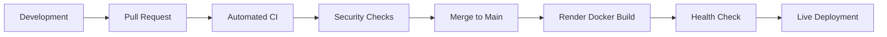

# Aegis AI — Personal Agent

A privacy-first, local-first personal AI assistant designed to bring
intelligence, productivity, research and task automation into a
unified workspace.


## Live Demo

**Explore Aegis AI:** https://aegis-ai-369j.onrender.com

The public demo showcases the dashboard, assistant interface,
structured responses, Markdown tables and code examples.

The hosted version uses isolated, recorded examples rather than
live Gemini inference. No personal information, private credentials
or owner database is exposed.

> Free hosting may introduce a cold-start delay after inactivity.

## Project Vision

Aegis AI is being developed as a modular personal intelligence
platform that combines conversational AI with secure task execution,
research, productivity tools and personal workflow management.

The project prioritizes:

- Privacy and user-controlled permissions.
- Local-first storage and execution.
- Modular, extensible architecture.
- Secure cloud AI integration.
- Automated testing and continuous deployment.
- Incremental delivery of production-quality features.

## Current Features

### Conversational AI

- Live Gemini integration in the private local workspace.
- Multi-turn conversations with bounded context.
- Structured Markdown responses.
- Code blocks, tables and technical explanations.
- Copy responses and start new conversations.
- Model provider abstraction.

### Dashboard

- Separate Overview and AI Assistant workspaces.
- Responsive interface with collapsible navigation.
- Dark and light themes.
- System status and approval UI.
- Dedicated placeholders for future integrations.

### Authentication and Security

- Single-owner authentication.
- Argon2id password hashing.
- Session-based authentication.
- HttpOnly session cookies.
- Session expiration and revocation.
- Login attempt rate limiting.
- Backend gateway authentication.
- Request and origin validation.
- Application-level outbound AI policy enforcement.
- Configurable AI usage limits and emergency stop.

### Local Persistence

- SQLite database.
- Versioned database migrations.
- Owner and session storage.
- Login attempt tracking.
- AI usage tracking when application limits are enabled.
- Private runtime files stored outside the repository.
- Restrictive filesystem permissions.

### Deployment

- Multi-stage Docker build.
- Next.js and FastAPI in one container.
- Separate public demo backend.
- Non-root container execution.
- Automated container smoke tests.
- Health monitoring.
- Continuous deployment through Render.

## Architecture



## Technology Stack

| Layer | Technology |
|---|---|
| Frontend | Next.js, React, TypeScript |
| Styling | Tailwind CSS, CSS, Lucide |
| Backend | Python, FastAPI, Uvicorn |
| AI | Google Gemini, model provider abstraction |
| Database | SQLite |
| Authentication | Argon2id, session tokens |
| Testing | Pytest, HTTPX |
| Containerization | Docker |
| CI/CD | GitHub Actions, Render |
| Security | CodeQL, Gitleaks, Bandit, pip-audit, npm audit |

## Repository Structure

```text
Personal-Agent/
├── backend/
│   ├── aegis/
│   │   ├── api/
│   │   ├── models/
│   │   ├── schemas/
│   │   ├── security/
│   │   ├── services/
│   │   ├── storage/
│   │   ├── demo.py
│   │   └── main.py
│   ├── tests/
│   └── pyproject.toml
├── frontend/
│   ├── src/
│   │   ├── app/
│   │   ├── components/
│   │   └── lib/
│   └── package.json
├── deploy/
│   ├── start.sh
│   └── smoke.sh
├── docs/
├── .github/workflows/
├── Dockerfile
├── .dockerignore
├── render.yaml
└── README.md
```

## Local Development

### Prerequisites

- Python 3.12 recommended.
- Node.js 24.
- npm.
- Git.
- Docker (for public demo testing).

### Backend Setup

From the repository root:

```bash
cd backend
python3.12 -m venv .venv
source .venv/bin/activate
python -m pip install -e '.[dev]'
python -m pytest -q
```

### Private Runtime Configuration

Keep runtime credentials and databases outside the repository.

Recommended macOS location:

`~/Library/Application Support/AegisAI/`

The existing private runtime uses:

- `runtime.env` for backend AI configuration.
- `gateway.env` for internal gateway authentication.
- `aegis.sqlite3` for local persistence.

Initialize the database and owner account using the project's
CLI before attempting authenticated access on a fresh installation.

Never commit runtime credentials or copy the owner database
into the public deployment.

### Start the Private Backend

For an already configured private runtime:

```bash
cd backend
source .venv/bin/activate

set -a
source "$HOME/Library/Application Support/AegisAI/runtime.env"
source "$HOME/Library/Application Support/AegisAI/gateway.env"
set +a

AEGIS_CLOUD_ENABLED=1 \
AEGIS_CUSTOM_CLOUD_ENABLED=1 \
AEGIS_UNLIMITED_AI=1 \
python -m uvicorn aegis.main:app \
    --host 127.0.0.1 --port 8000
```

The unlimited flag disables application-level AI quotas,
not provider quotas. Omit it to retain local usage limits.

### Start the Private Frontend

In a separate terminal:

```bash
cd frontend

npm ci

export NEXT_TELEMETRY_DISABLED=1
export AEGIS_LOCAL_BACKEND=1
unset AEGIS_PUBLIC_DEMO GEMINI_API_KEY

set -a
source "$HOME/Library/Application Support/AegisAI/gateway.env"
set +a

npm run dev -- --hostname 127.0.0.1 --port 3000
```

Open http://127.0.0.1:3000.

## Run the Public Demo Locally

```bash
docker build -t aegis-demo:local .

bash deploy/smoke.sh aegis-demo:local

docker run --rm \
    --memory=512m \
    --memory-swap=512m \
    -p 127.0.0.1:8080:10000 \
    aegis-demo:local
```

Open http://127.0.0.1:8080.

No Gemini credentials are required for this demo.

## Application Environments

| Environment | Address |
|---|---|
| Private frontend | http://127.0.0.1:3000 |
| Private backend | http://127.0.0.1:8000 |
| Local Docker demo | http://127.0.0.1:8080 |
| Hosted public demo | https://aegis-ai-369j.onrender.com |

## Continuous Integration and Deployment



The pipeline includes:

- Backend unit and integration tests.
- ESLint and TypeScript validation.
- Frontend production builds.
- Docker builds and smoke tests.
- CodeQL analysis.
- Secret scanning.
- Python security scanning.
- Frontend and backend dependency audits.
- Workflow validation.

Render automatically deploys validated changes from main
using the After CI Checks Pass setting.

## Branch Strategy

| Branch | Responsibility |
|---|---|
| main | Stable production source |
| frontend | Dashboard and user interface |
| backend | APIs and application services |
| conversation | Conversational AI |
| database | Storage and migrations |
| security | Authentication and security |
| deployment | Hosting, Docker and CI/CD |

Changes are merged through pull requests after required
checks pass. Development branches are retained and synchronized
with main.

## Engineering Milestones

Initial public deployment — November 22, 2026:

- 359 automated backend tests passed.
- 18 GitHub CI checks passed on the deployment PR.
- Zero npm vulnerabilities reported during validation.
- Local Docker smoke-test memory usage: 88.2 MiB.
- Render free instance memory allocation: 512 MiB.
- First successful production deployment: 1 minute 7 seconds.
- Initial public hosting cost: $0/month within free-tier limits.

These measurements represent the initial release validation,
not sustained production performance guarantees.

## Development Roadmap

- [x] Project foundation
- [x] Dashboard and navigation
- [x] Model provider integration
- [x] Local database and migrations
- [x] Owner authentication
- [x] Conversational AI
- [x] Docker containerization
- [x] Public demo deployment
- [x] Continuous deployment
- [ ] Persistent conversation history
- [ ] Streaming AI responses
- [ ] Advanced code and mathematical rendering
- [ ] Memory management
- [ ] Permission and approval engine
- [ ] Task planning and execution
- [ ] Job search assistant
- [ ] Email and calendar integrations
- [ ] Browser and research agents
- [ ] Automated personal workflows

## Security and Privacy

The private workspace and public demo have separate runtime
boundaries.

The public container does not run the owner API, open the private
database, accept arbitrary AI prompts or call Gemini.

Private cloud chat sends user-submitted text and enabled context
to Gemini. Users must not submit private or sensitive information.
Application-level filtering cannot guarantee detection of all
sensitive information.

The current security controls are not an operating-system sandbox.
External actions and autonomous execution are not enabled.

## Project Status

Aegis AI is under active development.

The current MVP demonstrates conversational AI, authenticated
local operation, local persistence, security foundations and a
reproducible deployment pipeline.

## Author

**Venkata Sri Sai Surya Mandava**

Software Engineering | Distributed Systems | Applied AI

GitHub: https://github.com/VenkataSriSaiSuryaMandava

Live demo: https://aegis-ai-369j.onrender.com
